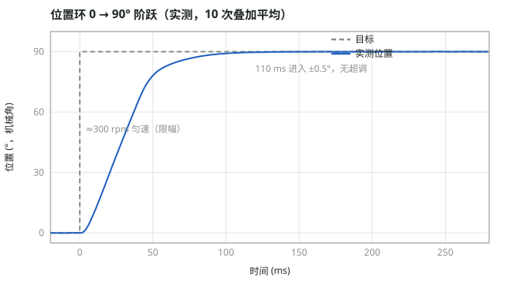

# stm32-foc

从零实现的三相永磁同步电机（PMSM）磁场定向控制，运行在 STM32G431 上。不依赖任何第三方电机库：
坐标变换、SVPWM、电流环、速度环、位置环、六步换相全部自己实现，控制算法层与硬件无关，可以在 PC 上做单元测试，
也能通过 Simulink C Caller 直接放进仿真模型。

整个项目按同一套方法推进：**测量被控对象 → 建模 → 按模型计算控制器参数 → 仿真 → 单元测试 → 上板实测 → 对比并解释差异**。

## 实测结果

### 电流环：d 轴阶跃 0.2 → 1.0 A


| 指标 | 实测 | 仿真 / 设计 |
|---|---|---|
| 阶跃第一拍电压指令 | 5.09 V | 5.07 V |
| 稳态 vd | 3.21 V（= R × 1 A） | 3.21 V |
| d 轴阶跃时的 q 轴电流 | 全程 \|iq\| < 0.012 A（电角度误差 < 1°） | 0 |
| 穿越频率 / 相位裕度 | — | 1 kHz / 63° |

转子不转（只给 d 轴电流）时 d 轴就是一个纯 R、L 电路，可以和单轴模型逐点对比。实测上升略快于仿真，拟合等效电感约 0.81 mH。
详见 [docs/M7_电流闭环.md](docs/M7_电流闭环.md)。

### 电机参数辨识（与厂家参数对比）

| 参数 | 实测 | 厂家标称 | 方法 |
|---|---|---|---|
| 极对数 | 7.004 | 7（12N14P） | d 轴电压拖转 14 圈电角度，数编码器计数 |
| 相电感 | 0.88 mH | 0.86 mH | d 轴电压阶跃、叠加 128 次平均，拟合一阶时间常数 |
| 相电阻 | 3.21 Ω | 2.55 Ω | 多个直流电压点线性拟合 U = R·I + U0，截距分离死区压降（实测含连接线和接插件） |
| 磁链 | 3.1～3.3 mWb | 3.5 mWb | 恒 iq 加速时 vq − R·iq 对电角速度的斜率（用指令电压，未扣死区，偏小） |
| Kt/J | 1.1 × 10⁴ rad/(s²·A) | — | 三个 iq 下同一转速区间的加速度做线性拟合，斜率与摩擦自动分离 |
| 摩擦 | B/J = 0.97 /s，Tc/J = 183 rad/s² | — | iq = 0 滑行时减速度对转速线性拟合 |
| 空载转速 @ 12 V | 预测 ≈ 2600 rpm | 2600 rpm | 电压用完、iq 下降到"转矩 = 摩擦"的平衡点 |

详见 [docs/M8a_q轴电流测试.md](docs/M8a_q轴电流测试.md)。

### 位置环：0 → 90° 阶跃



| 指标 | 实测 | 单元测试（三环 + 电机模型） |
|---|---|---|
| 进入 ±0.5° | 110 ms | 112 ms |
| 峰值 | 90.05°（无超调） | 90.06° |
| 稳态 | 90.01°（< 1 个编码器计数 0.088°） | — |

保持在 0° 时用手推转子：iq 立即顶到限幅 0.4 A，最大推开 108°，松手后 0.1～0.5 s 回到 0° ± 0.1°（负载由速度环积分抵消，位置环无稳态误差）。
详见 [docs/M9_位置环.md](docs/M9_位置环.md)。

### 六步换相 vs FOC（同一电机、同一硬件、同一转速）


六步换相用编码器模拟霍尔扇区，悬空相用定时器 OSSR + 关闭 CCxE/CCxNE 实现。在 677 rpm 下无扰切换到 FOC 对比：
空载电流只有约 20 mA，远小于单次采样噪声（±120 mA），所以按电角度分箱平均（每箱约 550 点）后再把 6 个扇区折叠到一起。

| | iq 平均 | 整圈标准差 |
|---|---|---|
| 六步换相 | 22.2 mA | 13.3 mA |
| FOC | 23.1 mA | 4.3 mA |

六步换相的 iq 在扇区中间最低、两头最高：电压模式下两相之间的平均电压恒定，而正弦反电动势电机的线反电动势在扇区中间最大，
把电流压了下去。这比 sin(超前角) 带来的 87%～100% 起伏大得多。详见 [docs/M10_六步换相.md](docs/M10_六步换相.md)。

### 速度环：600 ↔ 700 rpm 阶跃

稳态无误差（700.03 rpm），稳态 iq 与辨识出的摩擦一致，阶跃第一拍 iq 与设计完全相同（0.321 A）。
但实测超调大于设计、出现约 8 ms 周期的衰减振荡。排查过程：多电流点拟合确认 Kt/J 没有测错 → 转矩阶跃后测得的转速出现振铃 →
测试时电机用手按住，初步判断为安装刚度不足引起的约 100 Hz 机械谐振（双惯量）。电机刚性固定后复测中。
详见 [docs/M8b_速度环.md](docs/M8b_速度环.md)。

## 控制结构与设计参数

```
θ_ref ─►(−)─► 位置 P ─► ω_ref ─►(−)─► 速度 PI ─► iq_ref ─►(−)─► 电流 PI ─► vd, vq ─► 反 Park ─► SVPWM ─► 逆变器 ─► 电机
           ▲                 ▲                    ▲      （d 轴优先限幅）                                   │
           │                 └── 编码器测速 ◄──────┼───────────── Clarke / Park ◄── 三电阻采样 ◄────────────┤
           └──────────── 编码器累计位置 ◄───────────┴────────────────────────────── 编码器电角度 ◄──────────┘
```

| 环 | 周期 | 被控对象（穿越频率附近） | 设计 | 参数 | 相位裕度 |
|---|---|---|---|---|---|
| 电流环 | 50 µs | 1/(L·s + R) | 零极点对消，ωc = 2π × 1 kHz | Kp = L·ωc = 5.53 V/A，Ki = R·ωc | 63° |
| 速度环 | 1 ms | (Kt/J)/s | ωc = 2π × 50 Hz，PI 零点放在 ωc/4（加快消除摩擦） | Kp = ωc/(Kt/J) = 0.0286 A/(rad/s)，Ki = 2.24 A/rad | 55° |
| 位置环 | 1 ms | 1/s | 纯 P，ωc = 2π × 10 Hz，输出限幅 300 rpm | Kp = ωc = 62.8 /s | ≈ 85° |

- 电流环 PI：前向欧拉离散化、钳位抗积分饱和；电压矢量限幅 v_max = (2·d_max − 1)·Vbus/√3，d 轴优先
- 外环带宽依次比内环低 5～20 倍，内环在外环穿越频率处可近似为 1
- 位置环限幅满足 Kp_pos × ω_max < 最大减速度，保证减速过程不超调

## 硬件

| 项 | 值 |
|---|---|
| MCU | STM32G431CBU6（Cortex-M4F @ 170 MHz） |
| 开发板 | ST B-G431B-ESC1（MB1419-C01） |
| 功率级 | STL180N6F7 × 6 + L6387ED × 3，3 mΩ 三电阻低边采样，片上运放 PGA × 16 |
| 电机 | GM2804 云台电机，7 对极，12N14P |
| 位置传感 | MT6701 磁编码器，ABZ 1024 线（4096 计数/圈） |
| PWM | 20 kHz，中心对齐，死区 1.0 µs；TIM1_TRGO2 在 000 零矢量中心触发 ADC 注入组 |
| 电流分辨率 | 29.4 mA/LSB |

硬件常数与配置推导见 [HARDWARE.md](HARDWARE.md)。

## 目录结构

```
core/    平台无关的控制算法（C）：坐标变换、SVPWM、PI、dq 电流环、速度环、位置环
port/    STM32G431 适配层与 CubeMX / Keil 工程；main.c 里按 APP_MODE 切换各个实验
test/    PC 上的单元测试（gcc，2 万余项检查）：包括三环 + 电机模型 + 编码器量化的闭环仿真
sim/     MATLAB / Simulink 模型：电流环连续、离散、板子时序模型，以及用 C Caller 嵌入固件 PI 代码的模型
tools/   WSL 下编译烧录（Keil 命令行）、串口采集脚本
data/    各次上板的原始数据
docs/    每个阶段的设计、流程、预期与实测结果
```

## 构建与运行

```bash
make test                                  # PC 上跑单元测试
tools/keil.sh flash                        # 编译并烧录（需关闭 Keil 图形界面）
tools/serial_capture.sh 30 COM27 921600    # 先开串口、再复位板子，采集 30 s 输出
```

实验通过 `port/stm32g431/Core/Src/main.c` 里的 `APP_MODE` 切换：电流采样（M3）、电阻 / 电感辨识（M4b / M4c）、
电流闭环（M7）、q 轴恒流测机械参数（M8a）、速度环（M8b）、位置环（M9）、六步换相与 FOC 对比（M10）。

## 进度

- [x] 硬件配置、BOOT0 选项字节、三电阻电流采样（修复 ADC 注入组 JEOC/JEOS 导致的中断重复触发）
- [x] Clarke / Park / SVPWM，编码器电角度对齐与四点自检
- [x] 参数辨识：R、L、延迟、磁链、Kt/J、摩擦
- [x] 电流环：Simulink 仿真 + C Caller 验证固件 PI + 上板对比
- [x] 速度环、位置环上板
- [x] 六步换相（编码器模拟霍尔）与 FOC 对比
- [ ] 电机刚性固定后验证机械谐振，必要时加陷波滤波器
- [ ] 高调制区两相电流重构（高速时低边采样窗口不足会误报过流）
- [ ] 无感：观测器与编码器并行估计角度做对比

## 文档

| 文档 | 内容 |
|---|---|
| [docs/电流环控制基础.md](docs/电流环控制基础.md)、[docs/拉普拉斯与传递函数图解.md](docs/拉普拉斯与传递函数图解.md) | 理论笔记 |
| [docs/M7_电流闭环.md](docs/M7_电流闭环.md) | 电流环上板 |
| [docs/M8a_q轴电流测试.md](docs/M8a_q轴电流测试.md) | 机械参数辨识、高速误报过流分析、与厂家参数对比 |
| [docs/M8b_速度环.md](docs/M8b_速度环.md) | 速度环设计、实测与机械谐振排查 |
| [docs/M9_位置环.md](docs/M9_位置环.md) | 位置环 |
| [docs/M10_六步换相.md](docs/M10_六步换相.md) | 六步换相与 FOC 对比 |
| [docs/理解清单.md](docs/理解清单.md) | 每个阶段"必须能讲清楚"的问题与复核状态 |

## 开发说明

部分代码在 AI 编程助手（Claude Code）辅助下编写，提交记录中有标注。控制设计、参数辨识、上板调试与结果分析由作者完成；
AI 代写的部分在代码中标注了"待复核"，并在 [docs/理解清单.md](docs/理解清单.md) 中逐项记录了复核与理解情况。
