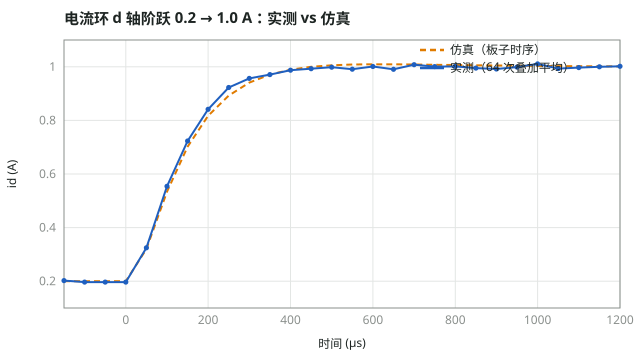
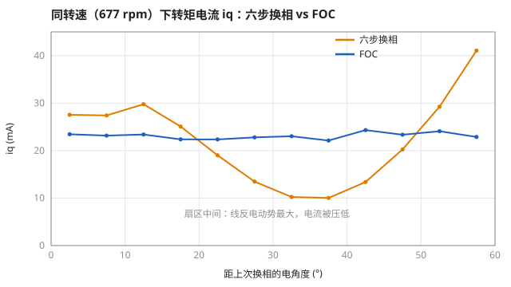

# stm32-foc

从零实现的三相永磁同步电机（PMSM）磁场定向控制，运行在 STM32G431 上，不依赖第三方电机库。
包括电流环、速度环、位置环三环串级控制，以及六步换相（用于和 FOC 对比）。控制算法层与硬件无关，可以在 PC 上做单元测试，
也能通过 Simulink C Caller 直接放进仿真模型。

方法：**测量被控对象 → 建模 → 按模型计算控制器参数 → 仿真与单元测试 → 上板实测 → 对比并解释差异**。

## 关键结果

| 项目 | 结果 |
|---|---|
| 参数辨识 | 相电阻 3.21 Ω、相电感 0.88 mH（厂家 0.86 mH）、磁链 3.2 mWb（厂家 3.5 mWb）、Kt/J = 1.1 × 10⁴ rad/(s²·A)；均为多点线性拟合，加速度对电流拟合的截距分离出摩擦 |
| 电流环 | 穿越频率 1 kHz、相位裕度 63°；d 轴阶跃首拍电压实测 5.09 V / 仿真 5.07 V，稳态无误差 |
| 速度环 | 穿越频率 50 Hz、相位裕度 55°，稳态无误差；实测超调偏大，初步定位为安装刚度不足引起的机械谐振，固定电机后复测中 |
| 位置环 | 90° 阶跃 110 ms 到位、无超调（三环仿真预测 112 ms）；外力推开 108° 后回到原位 ±0.1° |
| 六步换相 vs FOC | 同转速下六步换相的转矩电流脉动约为 FOC 的 3 倍：正弦反电动势电机的线反电动势在扇区中间最大，把电流压低 |





## 控制结构

```
θ_ref ─► 位置 P ─► ω_ref ─► 速度 PI ─► iq_ref ─► 电流 PI ─► vd, vq ─► 反 Park ─► SVPWM ─► 逆变器 ─► 电机
            ▲                ▲                     ▲                                               │
            └─ 编码器位置 ◄───┴─ 编码器测速 ◄─────────┴─ Clarke / Park ◄─ 三电阻电流采样 ◄────────────┘
```

| 环 | 周期 | 被控对象 | 设计 | 相位裕度 |
|---|---|---|---|---|
| 电流环 | 50 µs | 1/(L·s + R) | PI 零极点对消，ωc = 2π × 1 kHz | 63° |
| 速度环 | 1 ms | (Kt/J)/(s + B/J) | PI，ωc = 2π × 50 Hz，零点放在 ωc/4 以加快消除摩擦 | 55° |
| 位置环 | 1 ms | 1/s | 纯 P，ωc = 2π × 10 Hz，输出限幅 300 rpm | ≈ 85° |

## 硬件

ST B-G431B-ESC1（STM32G431，Cortex-M4F @ 170 MHz，3 mΩ 三电阻低边采样）+ GM2804 云台电机（7 对极）+ MT6701 磁编码器（4096 计数/圈）。
PWM 20 kHz 中心对齐，死区 1.0 µs，在 000 零矢量中心由 TIM1 触发 ADC 注入组采样。详见 [HARDWARE.md](HARDWARE.md)。

## 目录与构建

```
core/    平台无关的控制算法：坐标变换、SVPWM、PI、dq 电流环、速度环、位置环
port/    STM32G431 适配层与 Keil 工程；main.c 中用 APP_MODE 切换各个实验
test/    PC 上的单元测试，包括三环 + 电机模型 + 编码器量化的闭环仿真
sim/     MATLAB / Simulink 模型
tools/   WSL 下编译烧录、串口采集脚本
data/    上板原始数据
docs/    各阶段的设计、流程与实测结果
```

```bash
make test                                  # 单元测试
tools/keil.sh flash                        # 编译并烧录
tools/serial_capture.sh 30 COM27 921600    # 复位并采集串口输出
```

## 进度

- [x] 三电阻电流采样、Clarke / Park / SVPWM、编码器电角度对齐
- [x] 参数辨识：R、L、延迟、磁链、Kt/J、摩擦
- [x] 电流环（Simulink + C Caller 验证）、速度环、位置环上板
- [x] 六步换相与 FOC 对比
- [ ] 机械谐振验证与陷波滤波
- [ ] 高调制区两相电流重构
- [ ] 无感观测器

## 文档

[电流环](docs/M7_电流闭环.md) · [机械参数辨识](docs/M8a_q轴电流测试.md) · [速度环](docs/M8b_速度环.md) · [位置环](docs/M9_位置环.md) · [六步换相](docs/M10_六步换相.md) · [理论笔记](docs/电流环控制基础.md)
